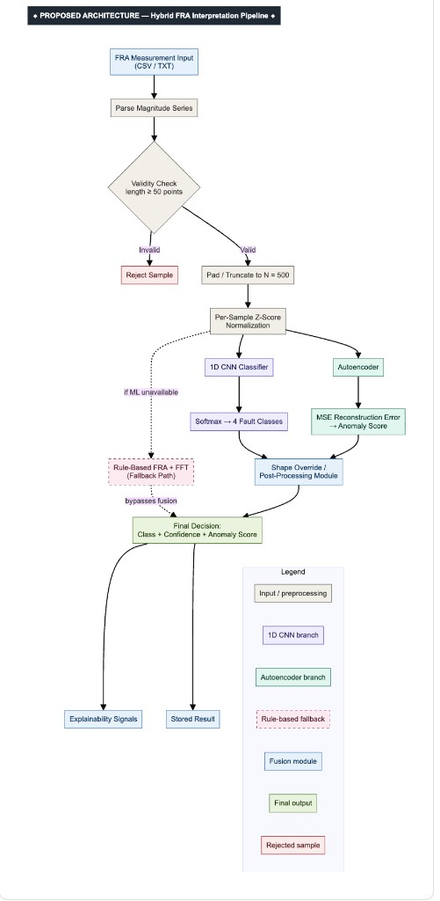
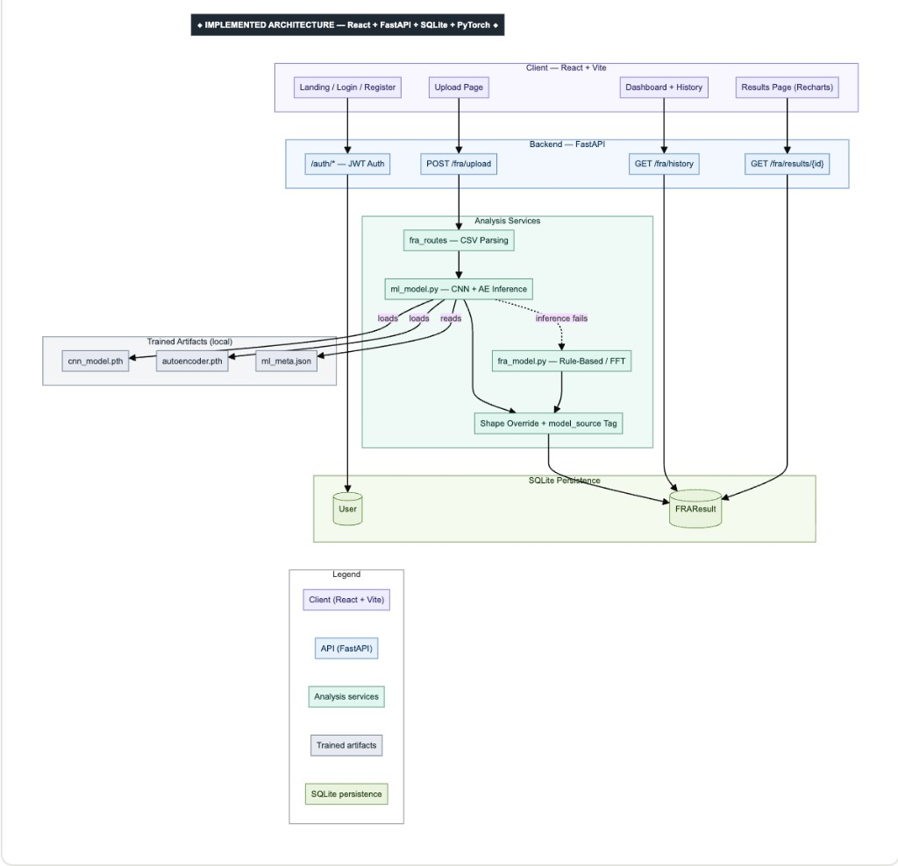
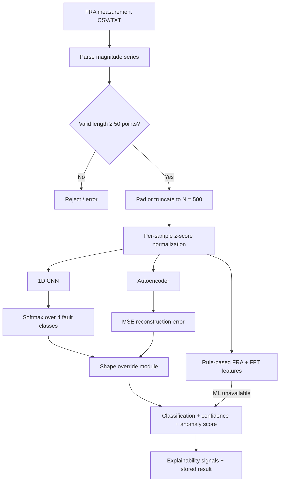
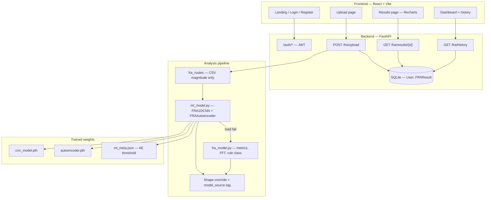

# IntelliFRA

### Automated SFRA fault diagnosis for power transformers — hybrid ML that turns frequency sweeps into actionable severity labels.

[](https://react.dev/)
[](https://vitejs.dev/)
[](https://fastapi.tiangolo.com/)
[](https://pytorch.org/)
[](https://www.sqlite.org/)
[](#license)
[](#installation--setup)
[](#acknowledgements)

<p align="center">
  <em>Upload an FRA sweep → classify winding condition → review confidence, anomaly score, and charts in seconds.</em>
</p>

---

## Table of contents

- [Overview](#overview)
- [Key features](#key-features)
- [Architecture](#architecture)
- [Tech stack](#tech-stack)
- [Installation & setup](#installation--setup)
- [Usage](#usage)
- [Model details](#model-details)
- [Mathematical formulation](#mathematical-formulation)
- [Dataset](#dataset)
- [Project structure](#project-structure)
- [Roadmap](#roadmap)
- [Contributing](#contributing)
- [License](#license)
- [Acknowledgements](#acknowledgements)

---

## Overview

Power transformers are critical assets. Mechanical or electrical winding deformation often shows up first in **Sweep Frequency Response Analysis (SFRA / FRA)** — a magnitude-vs-frequency fingerprint of the winding. Interpreting those curves by eye is slow, specialist-dependent, and hard to scale across fleets.

**IntelliFRA** is a web platform that automates that interpretation. Engineers upload CSV/TXT magnitude sweeps; a hybrid pipeline (1D CNN + autoencoder + shape-aware post-processing, with FFT rule fallback) returns one of four severity levels:

| Class | Meaning |
|-------|---------|
| **Normal** | Healthy / baseline-like response |
| **Minor Deviation** | Early structural or capacitive drift |
| **Moderate Fault** | Clear deformation / mode shift |
| **High Fault Risk** | Severe distortion — escalate inspection |

The goal is not to replace engineers — it is to give them a **consistent, fast first pass** with confidence scores, anomaly metrics, and visual frequency-response plots.

> **Academic note:** Models are trained on **physics-inspired synthetic SFRA** (ladder / multi-mode approximation), not proprietary utility field archives. Real CSVs are supported for practical validation. See [Dataset](#dataset).

---

## Key features

- 📤 **CSV / TXT upload** — magnitude-only parsing with validation (≥ 50 points), pad/truncate to 500
- 🧠 **Hybrid ML diagnosis** — 1D CNN classification + autoencoder anomaly scoring in one pass
- 🛡️ **Rule-based FFT fallback** — deterministic analysis when PyTorch weights are unavailable
- 📐 **Shape override** — reduces false “High Fault” calls on smooth, monotonic healthy curves
- 📊 **Dashboards & plots** — Recharts frequency-response visualization, history, and status cards
- 🎯 **Severity + confidence** — four-class softmax label with confidence and anomaly score
- 🔐 **JWT auth** — register / login, protected dashboard routes
- 📄 **Diagnostic report view** — in-app results with explainability signals (PDF export on roadmap)

---

## Architecture

**Request path:** React client → FastAPI (`POST /fra/upload`) → parse & normalize → CNN + AE inference (or rule fallback) → shape override → SQLite `FRAResult` → Results / History UI.

### Proposed (ML interpretation pipeline)



*Proposed: parse → validate → normalize → CNN + AE → shape override → class / confidence / anomaly; rule path if ML is unavailable.*

### Implemented (system stack)



*Implemented: React + Vite · FastAPI · SQLite · local PyTorch weights (`cnn_model.pth`, `autoencoder.pth`, `ml_meta.json`).*

<details>
<summary>Editable Mermaid sources</summary>

**Proposed**



**Implemented**



</details>

---

## Tech stack

| Layer | Technologies |
|-------|----------------|
| **Frontend** | React 19, Vite 8, React Router, Tailwind CSS, Framer Motion, Recharts, Three.js |
| **Backend** | FastAPI, Uvicorn, SQLAlchemy, JWT (`python-jose`), Passlib / bcrypt |
| **ML** | PyTorch (1D CNN + Autoencoder), NumPy, scikit-learn (metrics / split) |
| **Database** | SQLite (`User`, `FRAResult`) |
| **Data synth** | Physics-style SFRA generator (`physics_fra_synthesis.py`) |

---

## Installation & setup

**Prerequisites:** Node.js 18+, Python 3.10+, Git.

### Quick start

```bash
# Clone
git clone https://github.com/yuvraj20gole/IntelliFRA.git
cd IntelliFRA

# Frontend
npm install
npm run dev
# → http://localhost:5173

# Backend (separate terminal)
cd backend
python -m venv .venv
source .venv/bin/activate          # Windows: .venv\Scripts\activate
pip install -r requirements.txt
echo 'SECRET_KEY=change-me-in-dev' > .env
python -m uvicorn main:app --reload
# → http://127.0.0.1:8000
```

**Demo login:** `engineer@intellifra.com` / `demo123`

| Variable | Where | Purpose |
|----------|--------|---------|
| `SECRET_KEY` | `backend/.env` | JWT signing (required) |
| `VITE_API_BASE_URL` | frontend `.env` (optional) | Defaults to `http://localhost:8000` |

<details>
<summary>Full setup notes (venv, training deps, regenerate 50k)</summary>

**Backend extras for training**

```bash
cd backend && source .venv/bin/activate
pip install pandas 'numpy<2'   # train_models.py; pin numpy for older torch builds
```

**Regenerate dataset & retrain**

```bash
cd backend
python data/generate_dataset.py --samples 50000
python services/train_models.py
```

Weights land in `backend/models/` (`cnn_model.pth`, `autoencoder.pth`, `ml_meta.json`). Metrics are written to `backend/models/training_metrics.json` and (when configured) repo-root `model_accuracy.txt`.

**API docs:** http://127.0.0.1:8000/docs

</details>

---

## Usage

1. Start backend and frontend (see above).
2. Open http://localhost:5173 — register or use the demo account.
3. Go to **Upload**, select an FRA CSV/TXT with a magnitude column.
4. Review **Results**: severity class, confidence, anomaly score, frequency-response chart.
5. Browse **Dashboard / History** for prior analyses.

<details>
<summary>Example API flow</summary>

```bash
# Login
curl -X POST http://127.0.0.1:8000/auth/login \
  -H 'Content-Type: application/json' \
  -d '{"email":"engineer@intellifra.com","password":"demo123"}'

# Upload (use token from login)
curl -X POST http://127.0.0.1:8000/fra/upload \
  -H "Authorization: Bearer <token>" \
  -F "file=@your_fra.csv"
```

</details>

---

## Model details

IntelliFRA uses a **hybrid** stack: a supervised 1D CNN for severity classification, an unsupervised autoencoder for anomaly scoring, a shape-aware post-processor, and a rule/FFT fallback when PyTorch weights are unavailable.

### Models used

| Model / module | File | Purpose |
|----------------|------|---------|
| **FRA1DCNN** | `backend/services/ml_model.py` · `cnn_model.pth` | 4-class severity: Normal, Minor Deviation, Moderate Fault, High Fault Risk |
| **FRAAutoencoder** | `backend/services/ml_model.py` · `autoencoder.pth` | Reconstructs the curve; high MSE → anomaly |
| **AE threshold** | `backend/models/ml_meta.json` | Validation-calibrated reconstruction threshold $\tau$ |
| **Shape override** | `ml_model.py` (post-inference) | Tempers false High Fault on smooth / monotonic healthy shapes |
| **Rule + FFT fallback** | `backend/services/fra_model.py` (`analyze_fra`) | Deterministic path if ML load/inference fails (`model_source: rule_fallback`) |

### FRA1DCNN architecture

Input shape: `(batch, 1, 500)` after per-sample z-score normalization.

| Stage | Layer | Details |
|-------|--------|---------|
| Features | Conv1d | `1 → 16`, kernel 7, padding 3 + ReLU |
| | MaxPool1d | pool size 2 |
| | Conv1d | `16 → 32`, kernel 5, padding 2 + ReLU |
| | MaxPool1d | pool size 2 |
| | Conv1d | `32 → 64`, kernel 3, padding 1 + ReLU |
| | AdaptiveAvgPool1d | output length 16 → feature map `64 × 16` |
| Head | Flatten | |
| | Linear | `1024 → 128` + ReLU |
| | Dropout | $p = 0.2$ |
| | Linear | `128 → 4` logits → **Softmax** at inference |

### FRAAutoencoder architecture

Input / output length: **500** (flattened magnitude series).

| Part | Layers |
|------|--------|
| **Encoder** | Linear `500 → 256` + ReLU → `256 → 96` + ReLU → `96 → 32` (latent) |
| **Decoder** | Linear `32 → 96` + ReLU → `96 → 256` + ReLU → `256 → 500` (reconstruction) |

### Training configuration

| Hyperparameter | Value |
|----------------|--------|
| Optimizer | Adam, learning rate $1 \times 10^{-3}$ |
| Batch size | 32 |
| Epochs | 20 |
| CNN loss | Cross-entropy |
| AE loss | Mean squared error (MSE) reconstruction |
| Split | 80% train / 20% validation (seed 42) |
| Script | `backend/services/train_models.py` |

### Latest validation (50k synthetic set)

| Model | Metric | Score |
|-------|--------|------:|
| 1D CNN | Accuracy | **0.9441** |
| 1D CNN | Macro F1 | **0.9443** |
| Autoencoder | Normal vs Fault accuracy | **0.9847** |
| Autoencoder | Fault recall | **1.0000** |
| Autoencoder | Threshold $\tau$ | **0.022530** |

Full per-class tables and confusion matrices: [`model_accuracy.txt`](model_accuracy.txt) · `backend/models/training_metrics.json`.

---

## Mathematical formulation

Notation: magnitude series $\mathbf{x} = (x_1,\ldots,x_N)$, $N = 500$, small constant $\epsilon = 10^{-6}$.

### 1. Per-sample z-score normalization

Applied identically in training and inference:

$$
\mu = \frac{1}{N}\sum_{i=1}^{N} x_i, \qquad
\sigma = \sqrt{\frac{1}{N}\sum_{i=1}^{N}(x_i - \mu)^2}, \qquad
x_i' = \frac{x_i - \mu}{\sigma + \epsilon}
$$

### 2. CNN classification

$$
\hat{\mathbf{p}} = \mathrm{softmax}\big(f_{\mathrm{CNN}}(\mathbf{x}')\big), \qquad
\hat{y} = \arg\max_{k \in \{1,\ldots,4\}} \hat{p}_k
$$

Training objective (cross-entropy):

$$
\mathcal{L}_{\mathrm{CE}} = -\sum_{k=1}^{4} y_k \log \hat{p}_k
$$

Confidence reported to the UI is typically $\max_k \hat{p}_k$.

### 3. Autoencoder reconstruction & anomaly score

$$
\hat{\mathbf{x}}' = f_{\mathrm{AE}}(\mathbf{x}'), \qquad
e = \frac{1}{N}\sum_{i=1}^{N}(x_i' - \hat{x}_i')^2, \qquad
s_{\mathrm{anom}} = \frac{e}{\tau + \epsilon}
$$

where $\tau$ is the validation threshold stored in `ml_meta.json`. Samples with $e > \tau$ are treated as anomalous (fault-side) in the AE binary evaluation.

AE training objective:

$$
\mathcal{L}_{\mathrm{MSE}} = \frac{1}{N}\sum_{i=1}^{N}(x_i' - \hat{x}_i')^2
$$

### 4. Rule-based / FFT explainability features

From `fra_model.py` on the raw (or cleaned) magnitude series:

$$
E_t = \sum_{i=1}^{N} x_i^2, \qquad
E_s = \sum_{k=0}^{N/2-1}\big|\mathcal{F}(\mathbf{x})_k\big|
$$

plus mean, std, peak-to-peak, and zero-crossings. Binary flags (std / range / energy / spectral) drive the deterministic severity heuristic when ML is unavailable.

### 5. Shape-override features (post-ML)

$$
\Delta x_i = x_{i+1} - x_i
$$

- **Smoothness:** $\mathrm{std}(\Delta \mathbf{x})$
- **Monotonic ratio:** fraction of $\Delta x_i < 0$ (roll-off-like healthy curves)
- **Peak count:** local maxima along the series

These cues can downgrade an over-severe CNN label on smooth, largely monotonic responses.

### 6. Evaluation metrics

$$
\mathrm{Accuracy} = \frac{TP + TN}{TP + TN + FP + FN}, \qquad
P = \frac{TP}{TP + FP}, \qquad
R = \frac{TP}{TP + FN}, \qquad
F_1 = \frac{2PR}{P + R}
$$

---

## Dataset

| Property | Value |
|----------|--------|
| **Source** | Physics-inspired SFRA synthesis (not web-scraped field data) |
| **Generator** | `backend/data/generate_dataset.py` + `physics_fra_synthesis.py` |
| **Samples** | 50,000 curves (≈12,500 / class) |
| **Points / curve** | 500 magnitudes, log-spaced ~1 kHz–2 MHz |
| **Method** | Multi-mode Lorentzian / ladder-style resonances; fault taxonomy mapped to the 4 IntelliFRA labels |
| **Split** | 80% train / 20% val |

Regenerate: `python data/generate_dataset.py --samples 50000` then `python services/train_models.py`.

---

## Project structure

```text
intellifra-3/
├── src/
│   ├── pages/                 # Landing flow, Login, Register, Dashboard, Upload, Results
│   ├── components/            # UI, dashboard panels, charts, marketing sections
│   ├── auth/                  # Protected routes
│   └── lib/api.js             # API client (VITE_API_BASE_URL)
├── docs/
│   └── architecture/          # Proposed + implemented architecture PNGs
├── backend/
│   ├── main.py                # FastAPI app + CORS
│   ├── routes/                # /auth/*, /fra/*
│   ├── services/
│   │   ├── ml_model.py        # CNN + AE inference, shape override
│   │   ├── fra_model.py       # Rule / FFT baseline
│   │   └── train_models.py    # Training + metrics export
│   ├── data/
│   │   ├── generate_dataset.py
│   │   ├── physics_fra_synthesis.py
│   │   └── fra_dataset.csv    # Generated training set (large)
│   └── models/                # .pth weights, ml_meta.json, metrics
├── package.json
└── README.md
```

---

## Roadmap

- [ ] Add UI screenshots / GIF to README Usage (`docs/screenshots/`: landing, upload, results, dashboard)
- [ ] Validate / fine-tune on real FRA corpora (e.g. IEEE DataPort FD data, BHEL baselines)
- [ ] PDF report export and side-by-side curve compare
- [ ] Per-user history (`user_id` on `FRAResult`)
- [ ] Show `model_source` (ML vs rule) on Results
- [ ] Harden production config (`.env.example`, logging, CI)
- [ ] ML ops loop: generate → train → validate → promote weights

---

## Contributing

This is primarily an academic / FYP codebase, but thoughtful contributions are welcome.

1. Fork the repo and create a feature branch (`feat/...` or `fix/...`).
2. Keep UI redesign out of unrelated PRs unless the change is explicitly about design.
3. For ML changes, include regenerated metrics or a short note on how you validated.
4. Open a PR with a clear summary and test steps.

Bug reports and dataset pointers (public SFRA sources) are especially helpful.

---

## License

Released under the [MIT License](LICENSE).

---

## Acknowledgements

IntelliFRA is a **final-year academic / FYP** project on automated FRA interpretation for power transformers.

- SFRA fault-simulation ideas inspired by published ladder / SFRA methodology literature (e.g. MDPI Energies SFRA studies).
- Built with React, FastAPI, PyTorch, and the open-source community.

**Disclaimer:** Synthetic training performance does not guarantee field accuracy. Always validate against measured SFRA before operational or safety-critical use.
